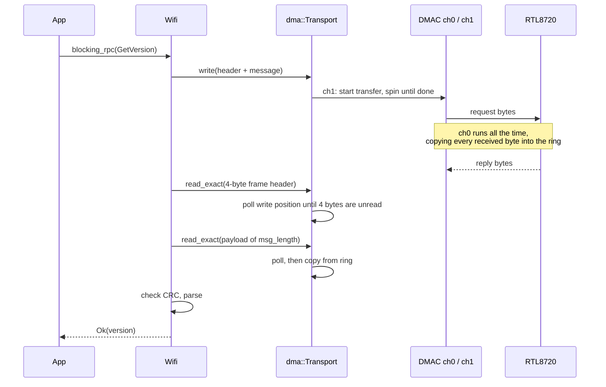
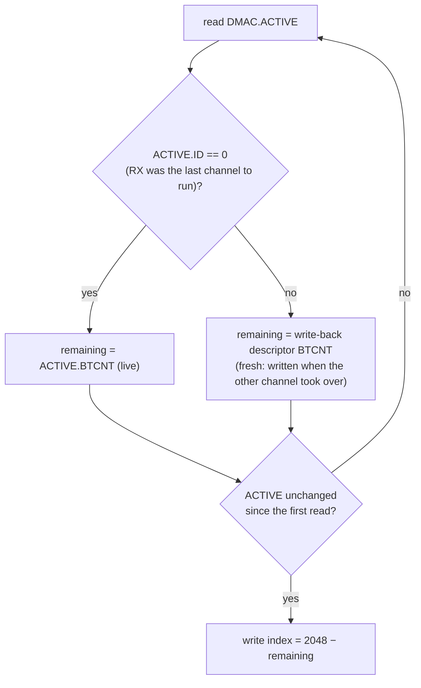
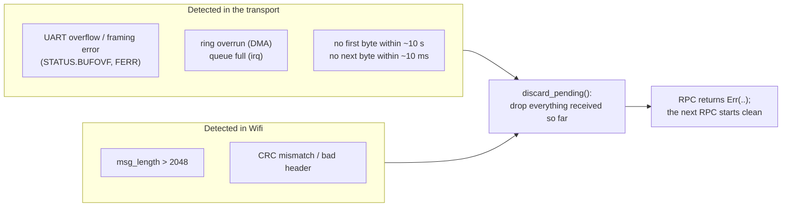

# Wifi DMA transport

How the `wifi-dma` feature moves the Wio Terminal's wifi UART from per-byte
interrupts to DMA, and why it is built the way it is.

## Why

The SAMD51 talks to the RTL8720 wifi chip through eRPC frames over SERCOM0 at
614400 baud: one byte every 16 µs. The UART's receive buffer holds two bytes,
so with one interrupt per byte, any other interrupt that blocks the CPU for
more than about 30–50 µs makes the receiver overflow and the RPC fails.

With DMA, the hardware moves every byte into RAM by itself. Other interrupts
can block the CPU for as long as they like; the bytes wait in RAM.

| `wifi_bench`, 1 kHz stall interrupt | Interrupt transport | DMA transport |
|---|---|---|
| Get Version round trip (avg) | 1003 µs | 1000 µs |
| ScanGetAP round trip (avg) | 20031 µs | 20033 µs |
| Transport interrupts per Get Version | 35 | 0 |
| CPU in transport interrupts | 4.2 % / 7.1 % | 0 % |
| Stall of 50 µs per ms | 10 of 60 RPCs fail | ok |
| Stall of 100–400 µs per ms | every RPC fails | ok |

Speed is the same: the UART line rate is the limit either way. The gain is
robustness and CPU time. Full numbers: [examples README](../examples/README.md).

## Layers

The RPC layer (`Wifi`) is shared. Only the transport underneath changes, and
the feature picks one at compile time.

```mermaid
flowchart TB
    app["Application<br/>blocking_rpc · connect_to_ap"]
    wifi["Wifi (src/wifi/mod.rs)<br/>eRPC framing · sequence numbers · CRC check · resync"]
    subgraph irq["irq::Transport (default)"]
        q["bbqueue RX 512 B / TX 128 B"]
        isr["SERCOM0_2 RX ISR, SERCOM0_0 TX ISR<br/>1 interrupt per byte"]
    end
    subgraph dma["dma::Transport (wifi-dma)"]
        ring["static RX ring, 2048 B"]
        ch0["DMA ch 0: circular, SERCOM0 RX trigger"]
        ch1["DMA ch 1: one-shot per request"]
        wrap["DMAC_0 ISR: counts ring wraps<br/>1 interrupt per 2048 B"]
    end
    uart["SERCOM0 UART · 614400 baud"]
    rtl["RTL8720"]

    app --> wifi
    wifi -- "write(frame) · read_exact(buf) · discard_pending()" --> irq
    wifi -- "same interface" --> dma
    isr <--> q
    isr <--> uart
    ch0 --> ring
    ch1 --> uart
    uart --> ch0
    uart <--> rtl
```



Both transports expose the same five methods (`new`, `enable`, `write`,
`read_exact`, `discard_pending`), so `Wifi` has no `cfg` beyond choosing one.
The only API difference is `wifi_init`: with `wifi-dma` it takes the two DMA
channels instead of using two static `BBBuffer`s.

## One RPC on the DMA transport



The CPU still waits for the reply, as it did before: `blocking_rpc` is
blocking by design. The difference is that it waits by polling memory and two
registers, and any interrupt may preempt it for any length of time without
data loss.

## The receive ring

Channel 0 runs one circular transfer for the life of the program: its
descriptor links to itself, so after the 2048th byte it starts again at
index 0. The transport never stops or restarts it.

```text
            read_total % 2048                 write index
                   │                               │
                   ▼                               ▼
 ring  ┌───────────┬───────────────────────────────┬──────────────┐
       │  already  │   unread: written, not yet     │  free / old  │
       │   read    │   consumed by read_exact       │    bytes     │
       └───────────┴───────────────────────────────┴──────────────┘
       0                                                         2047

 written_total = wraps × 2048 + write index      (wraps: counted by DMAC_0)
 unread        = written_total − read_total      (both u32, wrapping)

   unread == 0        → wait (poll again)
   0 < unread ≤ 2048  → copy the next byte
   unread > 2048      → the DMA overwrote unread bytes → Err(Rx), resync
```

Both totals are `u32` counters that wrap. 2048 divides 2³², so
`read_total % 2048` is always the right ring index.

## Reading the write position

This is the subtle part. The DMAC keeps a channel's live beat counter
(BTCNT) internally and copies it to the write-back descriptor in RAM **only
when another channel takes over**. While channel 0 was the last channel to
run, the write-back copy is stale. The plan's first version trusted the live
register only while `ACTIVE.ABUSY` was set, and the second RPC hung waiting
for bytes that had already arrived.



Facts established on hardware while building this:

- `ACTIVE.ABUSY` stays set while channel 0 idles waiting for its next
  trigger, so it cannot be used as "burst finished". Waiting for it to clear
  deadlocks.
- `ACTIVE.BTCNT` keeps channel 0's live count after `ABUSY` clears, as long
  as no other channel has run.

`written_total` adds the wrap count. A wrap can complete between the reads,
before the `DMAC_0` handler has counted it, so a pending transfer-complete
flag counts as one more wrap, and the whole read is retried until the count
and the flag are unchanged around it. If a wrap lands on the exact cycle the
block completes, the total can read one ring length behind for a single
poll. `read_exact` treats a negative `unread` as "nothing new yet", not as an
overrun.

## Errors and resynchronisation

Both transports report errors instead of panicking, and `Wifi` turns them
into RPC errors.



- The two timeouts are counted in polling iterations, because the transport
  owns no timer. The first byte of a reply may take long (`WifiConnect`
  blocks on the RTL8720 until it has associated). Once a frame has started,
  the RTL8720 sends it back to back, so a gap of more than about 10 ms means
  bytes were lost. Both figures are estimates, not calibrated.
- On the interrupt transport, after a UART error, the RX handler must flush
  the receiver (`flush_rx_buffer`). The HAL's `read()` leaves the error flag
  and the data in place, so without the flush every later `read()` fails and
  the RX interrupt fires forever. The old code hid this by panicking.

## Resources

| | Interrupt transport | DMA transport |
|---|---|---|
| RAM (`wifi_connect` bss) | 708 B | 2576 B (+1868: the 2 KiB ring) |
| Flash (`wifi_connect` text) | 15000 B | 15564 B |
| DMA channels | none | 0 (RX), 1 (TX) |
| Interrupts | `SERCOM0_0`, `SERCOM0_2` | `DMAC_0` |
| Interrupts per received byte | 1 | 1 / 2048 |
| HAL feature | none | `atsamd-hal/dma` |

## Known limits

- **Polling `ACTIVE` and the write-back descriptor** relies on DMAC behaviour
  established on hardware, not on a documented guarantee.
- **The ring is read through a raw pointer** while the HAL's `Transfer` owns
  the `&'static mut` buffer. Only volatile reads are used and no reference to
  the buffer is formed, the same pattern as the HAL's own DMA code.
- **A UART overflow can still happen with DMA.** In a 5-minute `wifi_scan`
  soak test, polling `IsScanning` in a tight loop, `SERCOM0.STATUS.BUFOVF`
  occurred within about a minute, losing up to ~8 consecutive bytes. The
  interrupt transport fails the same soak test (queue overrun). The cause is
  unknown. It now produces a failed RPC and a retry, not a hang. Ruled out:
  polling rate, the TX DMA channel, an attached debugger, stale write-back.
- **Debugging tip:** ending a `probe-rs` session clears `DEMCR.TRCENA`, which
  stops the DWT cycle counter after the firmware enabled it. `wifi_bench`
  re-enables it before each measurement.
